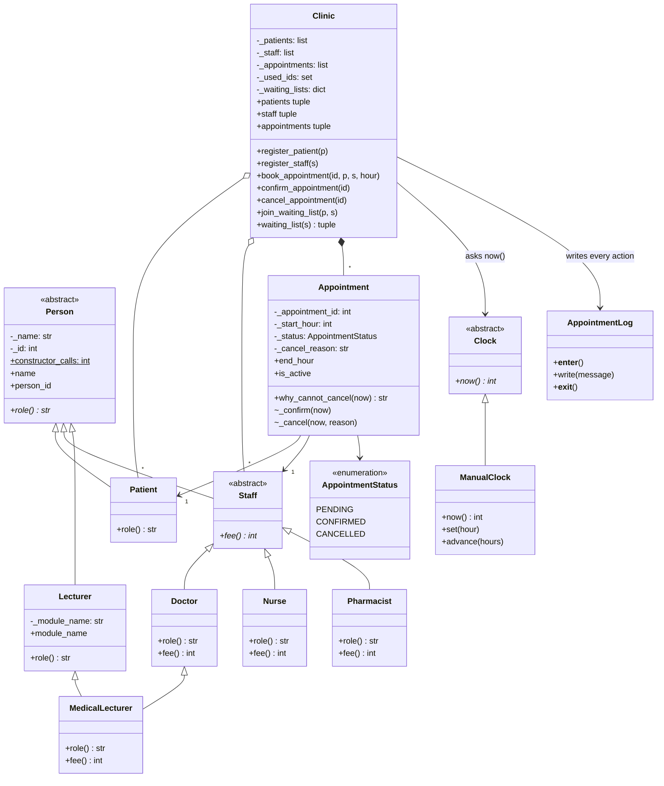

# Clinic Appointment System

A clinic booking system written in **Python 3.10+**. All the code is in `main.py`, and the tests are in `test_clinic.py`.

Time is a whole number of hours from 0 to 168 (one week). Every appointment lasts exactly 1 hour. The code never reads the computer clock. It always asks a `Clock` object for `now()`.

## P value and twist

- **P = 2,420,420**, the numeric part of student number R2420420. The brief does not say how P is chosen, so this is our assumption.
- Doctor fee = 40 + 5 × (P mod 5) = 40 + 5 × 0 = **40**
- Nurse fee = 10 + (P mod 3) = 10 + 2 = **12**
- Pharmacist fee = **5**
- **P mod 4 = 0**, so our twist is the **waiting list**.

## How to run

```text
python main.py                 # 5-minute demo of every feature
python -m unittest -v          # 36 tests
```

The demo prints `[log] opened`, every logged action (for example `FAILED cancel #30: too late ...`), and `[log] closed`. It ends with a deliberate crash to show the log still closes. The same lines are written to `appointments.log`.

## Class diagram



## Part 1: Classes

`Person` (abstract: name, id, abstract `role()`), `Patient`, `Staff` (abstract `fee()`), `Doctor`, `Nurse`, `Pharmacist`, `Appointment` and `Clinic`. These are all in `main.py` and shown in the diagram above. We also added `Lecturer`, `MedicalLecturer`, `Clock`/`ManualClock`, `AppointmentStatus` and `AppointmentLog`.

## Part 2: Encapsulation and rules

**Hiding fields.** Python has no `private` keyword. We follow its convention instead: every field starts with `_`, and outside code only reads values through `@property` getters with no setters. Assigning to a property, as in `appointment.status = ...`, raises `AttributeError`.

**Not handing out internal lists.** `Clinic.patients`, `.staff`, `.appointments` and `.waiting_list(s)` return a new **tuple** each time. A tuple is a read-only copy, so a caller cannot add to or remove from the clinic's real lists. There is a test for this.

**How a status changes.** Only through the Clinic: `confirm_appointment(id)` and `cancel_appointment(id)`. These call `Appointment._confirm()` and `_cancel()`. The leading `_` marks those methods as internal: `Appointment` has no public `confirm`/`cancel`, so outside code cannot skip the Clinic's logging and waiting-list handling.

**Legal transitions** (stored as a table, `Appointment._LEGAL_MOVES`):

| From      | To                    |
|-----------|-----------------------|
| PENDING   | CONFIRMED, CANCELLED  |
| CONFIRMED | CANCELLED             |
| CANCELLED | (nothing, ever)       |

Every change goes through `_move_to()`, which rejects any move that is not in the table. Extra rules, checked in `why_cannot_cancel(now)`:

- A cancelled appointment can never come back. CANCELLED has no outgoing moves.
- A CONFIRMED appointment cannot be cancelled less than 2 hours before it starts. Exactly 2 hours before is allowed.
- No appointment can be cancelled once it has started (`now >= start_hour`). An appointment also cannot be confirmed once it has started.

**Rejecting bad constructor input.** `require_name()` strips spaces and rejects empty names. `require_positive_id()` uses `operator.index()`, which only accepts real whole numbers, and then rejects anything ≤ 0. `True`/`False` are rejected too. There are no `isinstance` checks.

**Invariants** are written as comments directly above `class Appointment` and `class Clinic` in `main.py`.

## Part 3: Fees with no type checks

```python
for staff_member in clinic.staff:
    print(staff_member.role(), "fee:", staff_member.fee())
```

Each subclass overrides `role()` and `fee()`, and Python calls the right version for each object at run time (polymorphism / dynamic dispatch). The loop and the Clinic only use the `Staff` interface, so adding a new subclass needs no edits to either. A test adds a brand-new `Physiotherapist` class and books it without changing anything else. Another test checks that `main.py` contains no `isinstance(` or `type(`.

## Part 4: The log

We use Python's **context manager / `with` statement** (`__enter__` and `__exit__`, which is the same idea as Java's try-with-resources):

```python
with AppointmentLog("appointments.log") as log:
    clinic = Clinic(clock, log)
    ...
```

- `__enter__` opens the file and prints `[log] opened`. Opening the same log a second time raises `LogError`, so it is opened **exactly once**.
- `__exit__` always runs, whether the block ends normally or with an exception. It closes the file and prints `[log] closed` from a `finally`, so the log is closed **exactly once**.
- The `@logged_action` decorator wraps each Clinic action. It writes `<action>: OK` on success, or `FAILED <action>: <reason>` on failure and then re-raises the error, for example `FAILED cancel #30: too late (...)`.
- The demo ends with a deliberate `RuntimeError`. The output shows `[log] closed` printed before the program reports the error.

## Part 5: MedicalLecturer

`class MedicalLecturer(Doctor, Lecturer)`. Its **MRO** (method resolution order) is `MedicalLecturer → Doctor → Staff → Lecturer → Person`. Person appears only once, and every `__init__` calls `super().__init__(...)`, so `Person.__init__` runs **once**. The demo and a test check this with the `Person.constructor_calls` counter. `role()` returns `"Doctor and Lecturer"`.

`MedicalLecturer.fee()` returns the **Doctor fee (40)**. The clinic only charges for clinical work. A MedicalLecturer seeing a patient is working as a doctor, and lecturing is not a clinic service.

**In Java**, a class cannot extend two classes. `Lecturer` would become an `interface Lecturer { String getModuleName(); }`, and we would write `class MedicalLecturer extends Doctor implements Lecturer`. The `moduleName` field and its getter would move into `MedicalLecturer` (or a small helper object it holds), because interfaces cannot have instance fields. A plain lecturer would then be a separate class like `class BasicLecturer extends Person implements Lecturer`. This also solves the "one Person" problem in Java, because only the `Doctor` path inherits from `Person`.

## Part 6: Rules between objects and the twist

- **No double booking.** `Clinic._clash()` rejects a booking if the patient *or* the staff member already has a non-cancelled appointment at that hour. Cancelled appointments free the hour again.
- **Unique ids.** One set, `_used_ids`, holds patient, staff **and** appointment ids, so an id can never be used twice anywhere in the clinic.
- **Failing cleanly.** All checks run *before* anything is stored, so a failed booking changes nothing. It raises `ValueError` with a clear reason, and the decorator logs `FAILED book #N: <reason>`. Bookings for hours that have already started are rejected too.
- **Twist 0: waiting list.** `join_waiting_list(patient, staff)` adds a patient to that staff member's queue (no duplicates). When `cancel_appointment()` succeeds, the Clinic goes through the queue in order and gives the slot to the **first patient with no clash** at that hour, as a new **PENDING** appointment with the next free id. It logs `OFFERED freed slot (hour 15 with Dr. Ncube) to Ben as PENDING #51`. The offer is logged after the cancel line. If everyone on the list is busy, that is logged too.

## Part 7: Design decision log

**D1. Where does the 2-hour rule live?**
In `Appointment` (`why_cannot_cancel(now)`, with `MIN_NOTICE_TO_CANCEL_CONFIRMED = 2`). The Clinic asks the clock for `now` and passes it in.
Other places we considered:
- *Clinic*: it would keep Appointment simple, but the Clinic would grow into a "god class", and another class could change status without going through the rule.
- *Staff*: different staff could have different notice periods, but the rule is about the appointment's status and start time, not the person.
- *A separate `CancellationPolicy` object*: the most flexible option (easy to swap rules or have one per staff type), but it is one more class and the appointment would no longer protect its own invariant.

Trade-off: putting the rule in Appointment keeps it next to the data it protects (status and start hour), so it cannot be bypassed, at the cost of being harder to configure per clinic. If the rule needed to vary, we would move it to a policy object that the Clinic passes in.

**D2. Why is the clock design testable?**
Everything asks a `Clock` for `now()`, and tests use `ManualClock`, which only moves when we call `set()` or `advance()`. Tests can put the clock exactly 2 hours, 1 hour, 0 hours or −1 hours before an appointment and get the same result every run. If we had called the system time directly, we could not reliably test the 2-hour rule, the "already started" rule, the "can't book in the past" rule, or the boundary at exactly 2 hours. Results would depend on when the tests ran, and the demo could not jump forward in time.

**D3. Adding Pharmacist: what else changed?**
Nothing besides the new class (`role()` returns "Pharmacist", `fee()` returns 5). The Clinic, the fee loop and the booking rules all work through `Staff`, so nothing leaked. The `Physiotherapist` test proves the same for any future subclass.

**D4. MedicalLecturer.fee() and creating Person only once.**
`fee()` returns the Doctor fee (see Part 5). The language feature is Python's **MRO (C3 linearisation) with cooperative `super()`**: each class appears once in the MRO, and `super()` calls the *next* class in that order, not always the parent. Without it, for example if `Doctor` and `Lecturer` each called `Person.__init__(self, ...)` directly, Person's constructor would run **twice**. The counter would read 2, validation would run twice, and a constructor that registers or counts objects would count the same person twice.

**D5. What if writing to or closing the log fails?**
- *Write fails*: `write()` raises `LogError`. An action that cannot be recorded should not pass silently, because the log is the clinic's audit trail. The caller is told so it can stop or retry.
- *Close fails while another error is already happening*: we print a warning to stderr but **do not** replace the original error, because the original problem is the one the programmer needs to see.
- *Close fails on a normal exit*: we raise `LogError`, because the last lines may not have been saved.

In every case `[log] closed` is still printed from a `finally`, and `__exit__` returns `False`, so it never swallows errors.

**D6. Twist 0: who owns the waiting list, and why?**
The **Clinic** owns it (`_waiting_lists`, keyed by staff id). Offering a slot needs things only the Clinic knows: all appointments, so it can check the waiting patient for clashes, the set of used ids, so it can choose a new id, and the log. If the Staff object owned the list, Staff would need to reach into the Clinic. If Appointment owned it, a cancelled appointment would be creating new appointments. Keeping it in the Clinic also means outside code only gets a read-only tuple of the queue.

## Tests

`test_clinic.py` has 36 tests covering: constructor validation, fees, a new Staff subclass with no edits, no type checks in the source, one Person for MedicalLecturer, read-only lists, every legal and illegal status change, the 2-hour boundary, already started, double booking for patients and staff, unique ids, booking in the past, logging of successes and failures, the waiting list (including skipping a busy patient and log order), and the log opening and closing once even when writing, closing or the program fails.
