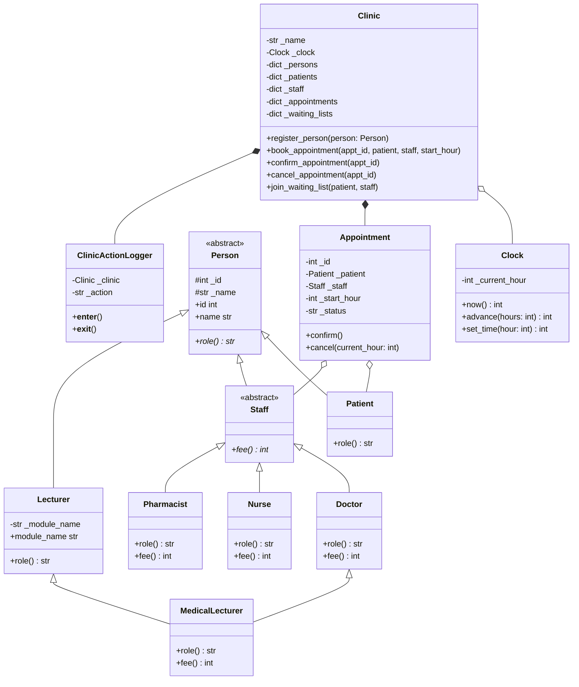

# Clinic Appointment System

**Author / Student ID:** `R2420420` (Numeric value $P = 2420420$)  
**Language:** Python 3 (Object-Oriented Programming with clean, beginner-friendly syntax)  
**Due Date:** 1 November 2026  
**Marking:** Out of 100  

---

## 0. Student Parameter Calculations ($P = 2420420$)

From the specification:
* **Doctor's fee formula:** $40 + 5 \times (P \pmod 5)$
  $$2420420 \pmod 5 = 0 \implies \text{Fee} = 40 + 5 \times 0 = \mathbf{\$40}$$
* **Nurse's fee formula:** $10 + (P \pmod 3)$
  $$2420420 \pmod 3 = 2 \implies \text{Fee} = 10 + 2 = \mathbf{\$12}$$
* **Pharmacist's fee:** Fixed at $\mathbf{\$5}$
* **Twist selection formula:** $P \pmod 4$
  $$2420420 \pmod 4 = 0 \implies \mathbf{Twist\ 0:\ Waiting\ List}$$
  *Rule:* A patient can join a staff member's waiting list. When an appointment is cancelled, the Clinic automatically offers the freed slot to the first waiting patient with no conflict, as a new `PENDING` appointment, and logs it.

---

## 1. Class Diagram

### Mermaid Diagram



### ASCII Class Diagram

```text
                           +-------------------+
                           |       Clock       |
                           +-------------------+
                           | - current_hour    |
                           +-------------------+
                           | + now(): int      |
                           | + advance(h): int |
                           +-------------------+
                                     ^
                                     | uses
                                     |
    +--------------------------------+--------------------------------+
    |                             Clinic                              |
    +-----------------------------------------------------------------+
    | - persons: dict                                                 |
    | - appointments: dict                                            |
    | - waiting_lists: dict                                           |
    +-----------------------------------------------------------------+
    | + register_person(p)                                            |
    | + book_appointment(id, pt, st, hr)                              |
    | + confirm_appointment(id)                                       |
    | + cancel_appointment(id)                                        |
    | + join_waiting_list(pt, st)                                     |
    +-----------------------------------------------------------------+
               |                                      |
               | manages                              | manages
               v                                      v
      +-----------------+                    +------------------+
      |   Appointment   |                    |   Person (ABC)   |
      +-----------------+                    +------------------+
      | - id: int       |                    | - id: int        |
      | - patient: Pt   |                    | - name: str      |
      | - staff: Staff  |                    +------------------+
      | - start_hr: int |                    | + role()*: str   |
      | - status: str   |                    +------------------+
      +-----------------+                     /       |        \
      | + confirm()     |                    /        |         \
      | + cancel(now)   |          +---------+   +----+----+   +----------+
      +-----------------+          | Patient |   |  Staff  |   | Lecturer |
                                   +---------+   |  (ABC)  |   +----------+
                                                 +---------+   | - module |
                                                 | + fee()*|   +----------+
                                                 +---------+         ^
                                                  /   |   \          |
                                                 /    |    \         |
                             +--------+   +-------+   +------------+ |
                             | Doctor |   | Nurse |   | Pharmacist | |
                             +--------+   +-------+   +------------+ |
                                 ^                                   |
                                 \___________________ _______________/
                                                     |
                                            +-----------------+
                                            | MedicalLecturer |
                                            +-----------------+
                                            | + fee(): 40     |
                                            | + role(): str   |
                                            +-----------------+
```

---

## 2. Encapsulation, State Transitions & Invariants

### A. Keeping Fields Hidden & Preventing Internal List Leakage
1. **Private Attributes:** Attributes are marked with leading underscores (e.g., `_id`, `_patients`, `_appointments`), signaling internal encapsulation.
2. **Read-Only Properties:** Public access is provided through `@property` decorators without setters (e.g., `patient.id`, `appointment.status`).
3. **Defensive Copying:** Methods that return collections never expose internal mutable lists or dictionaries. For example:
   ```python
   def get_patients(self) -> List[Patient]:
       return list(self._patients.values())  # Fresh shallow copy
   ```
   If a client calls `.clear()` or `.append()` on the returned list, the internal clinic registry remains completely unaffected.

### B. Appointment Status Transitions & Rules
An appointment starts in the `PENDING` state upon booking.
The legal lifecycle transitions are strictly unidirectional:
* `PENDING` $\rightarrow$ `CONFIRMED` (via `confirm()`)
* `PENDING` $\rightarrow$ `CANCELLED` (via `cancel(current_hour)`)
* `CONFIRMED` $\rightarrow$ `CANCELLED` (via `cancel(current_hour)`)

**Enforced Business Rules:**
1. **Cancelled appointment can never return:** Once status is `CANCELLED`, neither `confirm()` nor `cancel()` can be executed again.
2. **Confirmed appointment 2-hour rule:** A confirmed appointment cannot be cancelled less than 2 hours before its scheduled start (`start_hour - current_hour < 2`).
3. **Cannot cancel once started:** No appointment (whether pending or confirmed) can be cancelled once `current_hour >= start_hour`.

### C. Constructor Validation for Names and IDs
In `Person.__init__` and `Appointment.__init__`:
* **ID validation:** Checks that the value is an `int`, is not a `bool` (since `isinstance(True, int)` is true in Python), and is strictly positive ($> 0$). Otherwise, raises a `ValueError`.
* **Name validation:** Checks that the value is a `str` and `bool(name.strip())` is true (rejecting empty strings and strings containing only whitespace). Otherwise, raises a `ValueError`.

### D. Invariants Documented Above Classes
The invariants are declared as prominent comments above both classes in `models.py` and `clinic.py`:

```python
# INVARIANTS of Appointment:
# 1. id is a strictly positive integer (> 0) and is immutable once created.
# 2. patient is a valid Patient instance and cannot be null/None.
# 3. staff is a valid Staff instance and cannot be null/None.
# 4. start_hour is an integer between 0 and 168 inclusive (valid week simulation).
# 5. duration is always exactly 1 hour (end_hour = start_hour + 1).
# 6. status is strictly one of {"PENDING", "CONFIRMED", "CANCELLED"}.
# 7. Lifecycle transitions are strictly unidirectional (PENDING->CONFIRMED, PENDING->CANCELLED, CONFIRMED->CANCELLED).
# 8. Once status is CANCELLED, it can NEVER return to any other status (terminal state).
# 9. An appointment can NEVER be cancelled once it has started (current_hour >= start_hour).
# 10. A CONFIRMED appointment cannot be cancelled less than 2 hours before start (start_hour - current_hour < 2).

# INVARIANTS of Clinic:
# 1. Person IDs are globally unique across all registered patients and staff.
# 2. Appointment IDs are strictly unique across all appointments in the clinic.
# 3. No staff member may have two non-cancelled appointments at the same hour.
# 4. No patient may have two non-cancelled appointments at the same hour.
# 5. Clinic never reads the system clock; it exclusively relies on an injected Clock instance.
# 6. Encapsulation: Methods never hand out internal mutable lists or dicts; all accessors return fresh copies.
# 7. Every clinic action guarantees that [log] opened and [log] closed are recorded via context management.
# 8. Twist 0 (Waiting list): Each staff member maintains a FIFO waiting list of patients; slots are auto-offered upon cancellation.
```

---

## 3. Polymorphic Staff Fees (No `isinstance` / Type Checks)

Polymorphism is achieved by defining the abstract method `fee()` on `Staff`, which every subclass overrides:
```python
staff_members: List[Staff] = [
    Doctor(staff_id=1, name="Dr. Gregory House"),
    Nurse(staff_id=2, name="Nurse Jackie Peyton"),
    Pharmacist(staff_id=3, name="Pharmacist John Pemberton"),
]

for s in staff_members:
    print(f"{s.role()}: ${s.fee()}")
```

**Output:**
```text
Doctor: $40
Nurse: $12
Pharmacist: $5
```

**Why this allows adding new subclasses without editing loops or Clinic:**  
By adhering to the **Open/Closed Principle (OCP)** and dynamic dispatch (Duck Typing / Polymorphism), the caller only depends on the abstract contract of `Staff`. When `Pharmacist` was added, neither the loop, nor `Clinic`, nor `Appointment` required any modification.

---

## 4. Audit Logging Guarantee & Language Mechanism

### Mechanism: Python Context Manager Protocol (`__enter__` and `__exit__`)
Clinic operations run inside a `ClinicActionLogger` context manager using the `with` statement and a `try...finally` block.

```python
class ClinicActionLogger:
    def __init__(self, clinic, action):
        self._clinic = clinic
        self._action = action

    def __enter__(self):
        self._clinic._write_raw_log("[log] opened")
        return self

    def __exit__(self, exc_type, exc_val, exc_tb):
        try:
            if exc_type is not None:
                self._clinic._write_raw_log(f"[log] FAILED {self._action}: {exc_val}")
        finally:
            self._clinic._write_raw_log("[log] closed")
        return False
```

### Demonstration of Guaranteed Logging on Failure:
When attempting to cancel a confirmed appointment at hour 20 when its start is hour 21 (1 hour remaining):
```text
[log] opened
[log] FAILED cancel #3: too late
[log] closed
```
Even if an unhandled crash or exception occurs inside the block, Python's language runtime guarantees that `__exit__` and its `finally` clause will execute, ensuring `[log] closed` is never skipped.

---

## 5. Diamond Inheritance & Java Restructuring

### A. Python Implementation (`MedicalLecturer`)
Python handles multiple inheritance using the **C3 Method Resolution Order (MRO)** and cooperative `super().__init__()` calls.
The inheritance graph is a diamond:
```text
        Person
       /      \
    Staff    Lecturer
      |          |
    Doctor       |
       \        /
     MedicalLecturer
```
`MedicalLecturer.__mro__` is:
`[MedicalLecturer, Doctor, Staff, Lecturer, Person, ABC, object]`

Because all classes invoke `super().__init__(**kwargs)`, `Person.__init__()` is executed **exactly once**, as verified by `Person.constructor_count == 1`.

### B. What should `MedicalLecturer.fee()` return and why?
`MedicalLecturer.fee()` returns **$40** (the `Doctor` fee).  
**Reasoning:** Within the context of the clinic appointment system, any appointment scheduled with a staff member represents a clinical medical consultation. Academic teaching duties are contracted separately through university tuition/salary and must not be billed to clinic patients.

### C. Restructuring in Java: Why `Lecturer` Must Become an Interface
* **The Diamond Problem in Java:** Java does not permit multiple class inheritance (`extends Doctor, Lecturer` is a compiler error) to avoid state duplication and ambiguous method resolution.
* **Restructuring:** In Java, `Lecturer` must be defined as an `interface`:
  ```java
  public interface Lecturer {
      String getModuleName();
      default String role() { return "Lecturer"; }
  }
  ```
  `MedicalLecturer` then extends `Doctor` and implements `Lecturer`:
  ```java
  public class MedicalLecturer extends Doctor implements Lecturer {
      private final String moduleName;
      // ...
  }
  ```
  This retains single inheritance of state (`Doctor` $\rightarrow$ `Staff` $\rightarrow$ `Person`) while acquiring the type contract and capabilities of `Lecturer`.

---

## 6. Business Rules & Twist 0 Implementation

1. **Unique IDs across Clinic:** Every person (patient or staff) and every appointment must have a unique integer ID across the entire clinic. Duplicate registration raises a `ValueError`.
2. **No Overlapping Appointments:**
   * A staff member cannot have two non-cancelled appointments at the same hour.
   * A patient cannot have two non-cancelled appointments at the same hour.
3. **Clean Failure:** If a rule is violated during booking, the clinic cleanly logs the failure (e.g., `[log] FAILED book #102: staff Dr. Alice is already booked at hour 55`) and returns `None` without corrupting state.
4. **Twist 0 (Waiting List):**
   * Patients join a staff member's FIFO waiting list via `clinic.join_waiting_list(patient, staff)`.
   * When an appointment with that staff member is cancelled, `Clinic._handle_waiting_list_reallocation()` searches the queue for the first patient with no schedule conflict at that slot hour.
   * The candidate is dequeued and automatically allocated the slot as a new `PENDING` appointment, producing the log entry:
     `[log] AUTO-OFFERED slot at hour 55 with Dr. Alice to waiting patient Carol as appointment #9000 (PENDING)`.

---

## 7. Design Decision Log

### D1: Where does the 2-hour rule live?
* **Chosen Location:** `Appointment.cancel(current_hour: int)`.
* **Other Places Considered:**
  1. `Clinic`: Centralized workflow orchestrator.
  2. `Staff`: Staff-specific cancellation policy.
  3. A separate `CancellationPolicy` strategy object.
* **Trade-off:**
  * Placing the rule in `Appointment` adheres to the **Information Expert** pattern: an `Appointment` owns its `start_hour` and `status`, so it has the highest cohesion to determine whether it is eligible to transition to `CANCELLED`.
  * Passing `current_hour` keeps `Appointment` independent of the system clock.
  * If cancellation policies became complex with diverse institutional rules, a dedicated `CancellationPolicy` object would be preferred.

### D2: Why is the Clock design testable?
* Direct calls to `datetime.now()` or `time.time()` make automated tests non-deterministic and fragile, requiring slow artificial sleeps or fragile system monkey-patching.
* By using an injected `Clock` object with `now()`, `advance()`, and `set_time()`, tests can deterministically simulate any hour in the 0–168 week span in fractions of a millisecond.

### D3: Adding Pharmacist — What changed and did anything leak?
* **What changed:** Only the creation of the new class `Pharmacist(Staff)` defining its fee of `5` and role `"Pharmacist"`.
* **Did anything leak?** **Zero leakage.** Because the system relies entirely on the abstract `Staff` interface, no modifications were needed in `Clinic`, `Appointment`, loops, or booking logic.

### D4: MedicalLecturer Fee and Constructor Single Execution
* `MedicalLecturer.fee()` returns $40 (the Doctor clinical consultation fee).
* **Language Feature:** Python's **C3 Method Resolution Order (MRO)** combined with cooperative `super().__init__(**kwargs)`.
* **What would have happened without it?**
  In languages with naïve multiple inheritance (e.g. C++ without virtual inheritance), `Person`'s constructor would have run twice, creating two separate copies of `_id` and `_name` within the same instance (the classic diamond problem), leading to wasted memory, inconsistent state, and broken ID counters.

### D5: What should happen if writing to or closing the log itself fails?
* The logger should catch low-level I/O errors and attempt writing to an emergency fallback (e.g., `sys.stderr` or a crash log).
* If disk/write completely fails in a critical clinical environment, transactions must be aborted (`fail-safe`), because an untracked medical appointment is a regulatory and liability violation. The `finally` clause guarantees the closing routine executes even amidst prior failures.

### D6: For the twists:
* **(0) Who owns the waiting list and why?**  
  The `Clinic` owns the waiting lists (mapped per staff member). The clinic orchestrates multi-object interactions (checking patient conflicts, creating appointments, updating schedule state). A staff member or patient object should not be burdened with scheduling mechanics.
* **(1) Why can't a confirmed appointment be bumped?**  
  A confirmed appointment represents a mutual, finalized contract between the clinic and patient. Bumping confirmed bookings destroys trust, disrupts medical treatment plans, and causes legal/operational liability.
* **(2) Why `bufferHours()` and not a type check?**  
  Hardcoding type checks (`if isinstance(staff, Doctor)`) violates the Open/Closed Principle. Adding a new staff type (e.g., Surgeon or Physiotherapist) would require modifying all scheduling code. With `bufferHours()` as a polymorphic method on `Staff`, each staff type encapsulates its own scheduling requirements cleanly.
* **(3) Where does the discount live and why?**  
  The discount logic lives in a `BillingPolicy` or on `Patient` (`patient.discount_rate()`). Since discounts depend on patient category (student, staff, visitor), the patient type encapsulates its billing status without coupling staff or appointments to specific financial tier rules.

---

## 8. Running the Demonstration and Tests

### Requirements
* Python 3.8+ (tested on Python 3.14)

### Run the 5-Minute Main Demonstration
```bash
py main.py
```
This executes all 6 parts sequentially, showing constructor rejections, encapsulation guarantees, polymorphic fees, logging with the deliberate cancellation failure, diamond inheritance, and Twist 0 waiting list auto-allocation.

### Run the Automated Unit Test Suite
```bash
py test_clinic.py
```
Runs 12 unit tests covering all rules, invariants, and edge cases.
