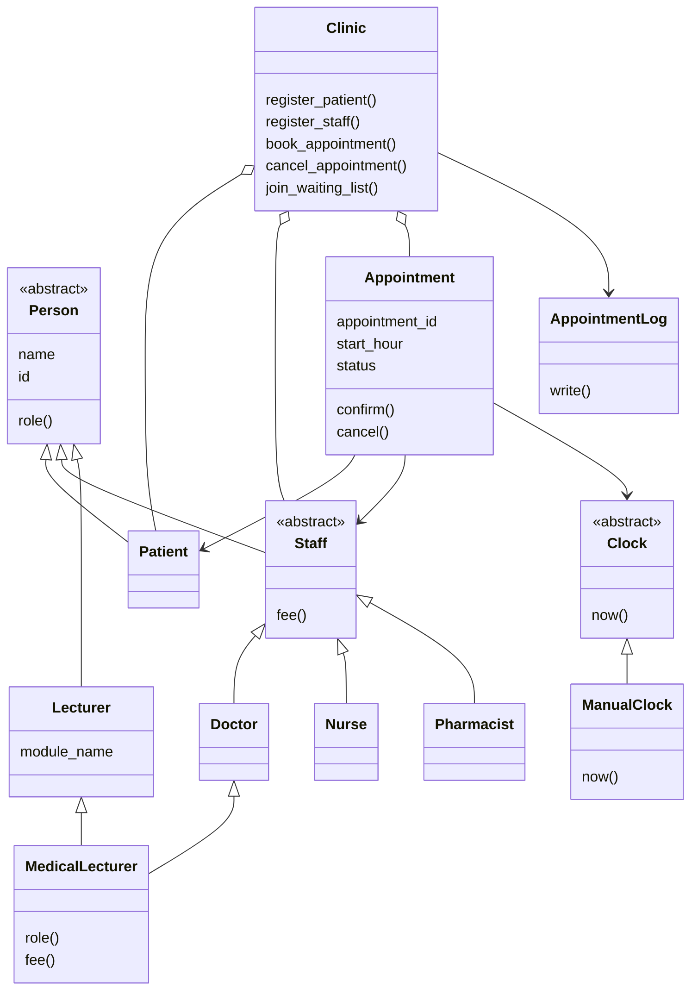

# Clinic Appointment System

## Language and P value

This project is written in Python.

**Working P value:** 2,420,420, using the numeric part of student number R2420420. The assignment does not specify how P is calculated, so this is an assumption.

**Working twist:** P mod 4 = 0, so the project uses a waiting list.

## How to run

Run the program:

```text
python main.py
```

Run the tests:

```text
python -m unittest -v
```

## Class diagram



## Design decisions

- **D1 — Cancellation rule:** The `Appointment` class enforces cancellation timing because it knows its start hour, status, and clock. A separate policy object could keep rules more separate, but would add another class.
- **D2 — Clock:** The clock is passed into appointments. A manual clock makes the current hour controllable during a demo and in tests. Reading the computer clock directly would make time-based tests unpredictable.
- **D3 — Adding Pharmacist:** The `Pharmacist` class provides its role and fee. The Clinic and staff-printing loop do not need changes because each staff object provides its own methods.
- **D4 — MedicalLecturer:** It uses the Doctor fee. The shared `Person` base and cooperative `super()` calls ensure the Person constructor runs once. Without that shared inheritance path, name and ID data could be initialized twice.
- **D5 — Log failures:** A write or close error is allowed to surface so the program does not claim a successful log when the file operation failed. The context manager still attempts to close the file when an action raises an error.
- **D6 — Waiting list:** The Clinic owns the waiting lists because it coordinates bookings and offers newly available slots. When a slot opens, it checks waiting patients in order and offers the slot to the first one without a conflict.